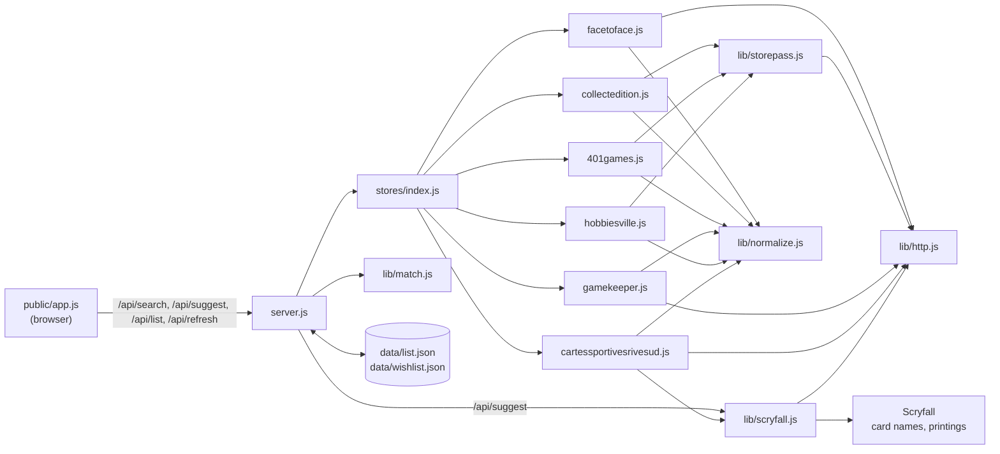

# Architecture

A small local web app with no build step: an Express 5 server, one adapter per store, and a vanilla JS page.
The server fetches each store's public search data on demand, normalizes it, and merges it into one row per
card printing. What the user decided against (and why) is in [DECISIONS.md](DECISIONS.md).



## Two modes

Every layer takes a `mode`:

| | `sell` (Selling) | `buy` (Buying) |
|---|---|---|
| Store call | `adapter.search(name)` | `adapter.searchRetail(name)` |
| Price shape | `{ cash, credit, retail }` | `{ price, stock }` |
| Best store | highest credit (or cash, per the UI toggle) | cheapest with `stock > 0` |
| Saved list | `data/list.json` | `data/wishlist.json` |

## Components

### `server.js`
- Serves `public/` and the JSON API (see [README](../README.md#api)).
- `searchAll(query, { mode, force })`:
  - Reduces the query to its front name (`frontName`).
  - Calls every adapter in parallel. A failing store is recorded in `errors` and contributes no offers; it never fails the whole search.
  - Merges the offers with `mergeOffers`.
- **Cache**: in memory, 10 minutes, keyed by `mode|query`. Results with any store error are **not** cached, so the next search retries that store.
- `GET /api/suggest?q=` (#52) returns `{ names }`: Scryfall's `/cards/autocomplete` (up to 20 card names). Scryfall is the only outside service that isn't a store (the server also asks it for printings, see [`lib/scryfall.js`](#libscryfalljs)); the page never calls it itself. Requests go through `scryfallGet()` with a 5 s timeout and no retry, and answers are cached in memory for a day (`SUGGEST_TTL_MS`, at most 1000, oldest out first). When Scryfall fails, the endpoint logs one line and returns `{ names: [] }`, so the page just shows no suggestions. Scryfall names two-faced cards `A // B`; that's fine, since searches use `frontName()`. It only knows oracle names, so flavor names printed on some Universes Beyond cards (e.g. "Lightning, Lone Commando" for Isshin, Two Heavens as One) get no suggestion; typing them and pressing Enter searches the stores as before.
- `POST /api/refresh` re-searches each distinct front name in the list (sequentially, `force: true`) and finds each item's row by `item.key ∈ row.keys`. An optional JSON body `{ keys: [...] }` limits it to those cards (the page always sends it, see below). A card keeps a store's **last known prices** only when **that card's** search failed at that store (`result.errors` per front name, #44); a store that failed for another card answered for this one, so its answer stands.
  - The searches take a while and the page keeps saving meanwhile, so the endpoint **re-reads the list before writing**, inside the write queue (below), and only sets `prices` / `updatedAt` on the refreshed cards (first moving the old ones to `prevPrices` / `prevUpdatedAt`, #51); stars, moves, removals and adds made during the refresh stay. Cards added meanwhile (their name wasn't searched) are left alone.
  - The page's `refreshPrices(groupId?)` (the whole list, or one sub-list: a wishlist list or a "Selling to" list) sends **one request per front name, at most 3 at a time** (`REFRESH_PARALLEL`, #44): about a third of the time of one sequential request, and it can show progress. After each response it copies only that batch's `prices` / `updatedAt` / `prevPrices` / `prevUpdatedAt` into its own items (matched by `key`), so edits made meanwhile stay and a late response can't put back another batch's older prices. When all are done it saves once more, in case a save sent while the server was writing put old prices back, then shows one message for the stores that failed. Running refreshes are tracked in `state.refreshing` (a `Map` from `${view}:${groupId}`, `''` = the whole list, to `{ done, total }`), so their buttons keep saying "Refreshing N / M…" through re-renders. The first failed request (the server, not a store) stops the rest.
- Lists are written atomically (write a uniquely named `*.tmp`, then rename), **one write at a time per list** (`queued(mode, task)`, #40). Before, overlapping saves shared one temp file and the second rename failed with a 500. `PUT /api/list` and the end of `/api/refresh` (re-read, update, write) both go through the queue.
- The lists live in `data/` unless `DATA_DIR` points elsewhere. `npm run start:test` copies both lists into `data-test/` and serves them on port 3999, so testing never touches the real files.
- Errors are returned as JSON (`{ error }`), because the page always parses JSON.

### `stores/*.js` — adapters
One file per store, registered in `stores/index.js`. The UI builds its columns from this registry.

```js
module.exports = {
  id: 'f2f',                // key in row.prices
  label: 'Face to Face',    // the store's name: header tooltip and alt text, lists, messages, print sheets
  logo: 'logos/f2f.png',    // column header (public/logos/; optional, the label shows without one)
  logoDark: 'logos/f2f-dark.png', // optional: the logo on the dark theme, when `logo` doesn't read on it
  online: false,            // true for a mail-order store (401 Games, Hobbiesville): its column goes on the right
  creditNote: 'cash + 30%', // header tooltip in Selling
  links: { buy, sell },     // store search pages, `{q}` = front name: the page's link for cards saved without a `url`
  search(name),             // -> Offer[] with { cash, credit, retail }
  searchRetail(name),       // -> Offer[] with { price, stock }
};
```

Each adapter maps its store's data onto a shared **printing identity** and then adds the mode's prices.
Per-store sources, fields and quirks are in [STORES.md](STORES.md).

### `lib/storepass.js`
Shared by Collect-Edition, 401 Games and Hobbiesville, whose buylists run on the Storepass platform.
- `fetchProducts(host, storeId, name)` makes one relevance-sorted request for up to 240 products (`limit=240`). Pages of 24 (the default) aren't stable under relevance sorting: some products repeat and others are skipped from one page to the next (see [STORES.md](STORES.md#collect-edition--storescollecteditionjs)).
- One response carries both the buylist offers and the Shopify retail variants, so both modes use it.
- `parseDisplayName(display)` and `readTags(tags, data)` read Collect-Edition's and Hobbiesville's display names: the name before the first ` (`, then from the `(…)` tags the set code and collector number (`(FIN-350)`, falling back to `product_data`), the special-foil label (`Surge Foil`) and the versions. Collect-Edition first cuts off its ` - <set name>` part. 401 Games names its products differently and has its own parser.

### `lib/scryfall.js`
Scryfall, for the server only (#52, #80). Its API guidelines ask for the app's own User-Agent (`mtg-price-checker/<version>`), an Accept header and 50–100 ms between requests, so every request goes through `scryfallGet(path, options)`, which starts them at least 100 ms apart (`GAP_MS`), name suggestions and printings alike.
- `printsByTcgplayerId(name)` (#80) maps TCGplayer product ids to `{ setCode, setName, collectorNumber }` for every printing whose name contains `name` (`"<name>" unique:prints`, extras included, at most 2 pages of 175). `tcgplayer_etched_id` maps an etched product too. Cached a day per name (at most 500, oldest out first). No card by that name (Scryfall's 404) is an empty map; other failures throw, and the caller decides (Cartes Sportives Rive-Sud falls back to set names, see [STORES.md](STORES.md#cartes-sportives-rive-sud--storescartessportivesrivesudjs)).

### `lib/http.js`
Every store request, and every Scryfall one, goes through `getJson(url, options)`, `getText(url, options)` (Game Keeper's HTML, Shopify pages) or `postJson(url, body, options)` (Cartes Sportives Rive-Sud's bulk prices; a POST that only reads, so it's retried like a GET). Options: `retries`, `userAgent` and `timeoutMs`.
- The stores get a browser-like User-Agent; Scryfall's requests pass their own (`userAgent`).
- Each request times out after 15 s by default (`timeoutMs`; `AbortSignal.timeout`, which also covers reading the body), with the error `timed out after 15 s for <url>` (#48). Without it, Node's fetch waits up to 5 minutes for the headers and 5 more for the body, so a store that accepted the connection and then stalled held up the whole search or refresh. A timed-out store is a failed store like any other: "couldn't reach", not cached, last prices kept on refresh.
- Dropped connections and 5xx answers are retried `retries` times (default 1), after 750 ms, 1.5 s, 2.25 s… Game Keeper passes `retries: 3` (4 attempts). A 4xx isn't retried (it would fail again), and neither is a timeout: a stalled store would hold the search another 15 s per attempt.

### `lib/normalize.js`
Turns each store's naming into comparable values:
- `normFinish` maps finishes to `nonfoil`, `foil`, `etched`, or a special foil label (`surge foil`, `rainbow foil`…). `finishGroup` collapses those to `nonfoil` / `foil` / `etched` for matching.
- `normTreatment` gives one vocabulary for versions (`Borderless`, `Extended Art`, `Showcase`, `Retro Frame`, `Promo`, `Serial Numbered`…).
- `normCollector`: `"057"` → `"57"`, `"252★"` → `"252"`, lowercased.
- `frontName`: the part before ` // ` or ` - `. Stores join two-name cards differently, so searches use only the front name.
- `looseSetName`: the set name as a sorted word set without filler words, so "Commander: X" matches "X Commander" and "Warhammer 40,000" matches "Warhammer 40000".
- `printingKeys` / `looseKey`: the matching keys (below).
- `coreVersions`: reduces version labels to core words for loose matching ("Borderless Poster" → `borderless`, "Showcase Scrolls" → `showcase`, "Bundle Promo" → `promo`). Labels with no core word are compared as-is.
- `isSerialized`: a `…z` collector number **or** a "Serial Numbered" / "Serialized" label. Serialized copies get a `z` number in `printingKeys` and a `serial numbered` version in `looseKey`, so they never merge with the regular printing (stores mark them differently: F2F `748z`, CE `LTR-748 (Serial Numbered)`).

### `lib/match.js` — `mergeOffers(offers, query, mode)`
1. **Relevance filter**: store searches are fuzzy, so only offers whose name contains the query are kept.
2. **Pass 1 (exact)**: offers with a collector number get `printingKeys`, which produces three kinds of key:
   - `setCode|number|finishGroup`
   - the same with each `altSetCodes` entry
   - `name:<looseSetName>|number|finishGroup`

   The offer joins the first row that already has any of those keys; otherwise it starts a new row. This is how `CEI` and `IED`, or `PFIN` and `PRE`, end up together.
3. **Pass 2 (loose)**: offers without a collector number (most of Game Keeper's) use `looseKey`, which is `front name | looseSetName | finishGroup | coreVersions`.
   - They join a row only if **exactly one** row has that key.
   - If several rows match, an exact special-foil label (`surge foil`) may single one out.
   - Otherwise the offer gets its own row. Ambiguous listings are never merged by guesswork.
4. **Same store twice in a row**: sell keeps the higher credit; buy keeps the in-stock listing, then the cheaper one.
5. **Output**:
   - sell: rows some store buys, highest credit first.
   - buy: rows some store lists, cheapest in-stock first (rows sold out everywhere go last).

### `public/` — the page
- `index.html` has the header (Selling | Buying, and Store credit | Cash), the search panel, and the list panel.
- `app.js` keeps state in one object: `view`, `sellValue`, `results`, `filters`, `lists: { sell, buy }`, and `excluded: { sell, buy }` (stores left out of the comparison, per view). `search: { seq, abort }` tracks the latest search: each search (and `clearResults()`) aborts the previous request, and a response renders only if it's still the latest, so a slow older search can't replace newer results (#37). `removed: { view, item, index, timer }` is the last card removed with ✕ (#43): `#undo-bar` shows "Removed <card> [Undo]" for 8 s (`UNDO_MS`), until the next removal, or until a tab switch. It's sticky just under the top bar (`--topbar-h`, set from the top bar's height on load and resize), so it's in view even after removing a card far down the lists. `undoRemove()` puts the same object back at its index (unless the card was added again meanwhile), so `starred`, `sellTo` / `group`, `qty` and prices come back with it, then saves.
  - Everything that differs by mode lives in the `MODES` config: the value read, eligibility, comparison, subtitle line, labels and totals note, and how sub-lists are grouped (`groupOf`, `setGroup`, `groups`).
  - The rendering functions (`bestStore`, `priceCell`, `renderResults`, `renderList`) are shared.
- Card name suggestions (#52): the search field is a `role="combobox"` with `#suggestions` (`role="listbox"`) under it. From 2 characters, a 200 ms pause in typing (`SUGGEST_DELAY_MS`) calls `/api/suggest`. Each request has a number (`suggest.seq`), and an answer is dropped if the user typed on, picked, searched or closed the list meanwhile. ↑ / ↓ move the highlight (`aria-activedescendant` on the field, `aria-selected` on the option). Past either end they wrap back to what was typed, with nothing highlighted. Enter with an option highlighted, or a click (the list cancels `mousedown`, so the field keeps the focus), puts that name in the field and searches it. Enter with nothing highlighted is the form's usual search of the typed text. Esc closes the list without clearing the field, and so does leaving the field or starting a search. Focusing the field doesn't open the list, so its select-on-focus behavior (#3) is unchanged.
- Clear search (#71): `#search-clear`, a ✕ over the right end of the search field, shows while the field has text or `#search-status` has something (a search running, its results' count, or its message): `renderSearchClear()`, called on input, at a search's start and end, and in `clearResults()`. It and Esc with no suggestions open call `resetSearch()`: close the suggestions, empty the field, `clearResults()` (which also aborts a running search), focus the field. The lists, refreshes and the undo bar are untouched. The browser's own ✕ for `type="search"` (`::-webkit-search-cancel-button`) is hidden: it only emptied the text.
- Store column headers show the store's logo (#82), about 24 px high and at most 36 px wide, so each column is as wide as its prices rather than its name. Prices are right-aligned and a column can be wider than them, so the logo is centered over a price box's width (75 px) at the header's right, not over the whole column. With `logoDark`, a `<picture>` serves it under `prefers-color-scheme: dark`. A store without a logo shows its name.
  - Hovering or focusing the header shows `.store-tip` at once, under it (anything above the table would be cut off by the sideways-scrolling `.table-wrap`): the store's name in bold, then its credit note (Selling) and what a click does. A `title` tooltip took a second or two to appear. The button's `aria-label` says the same; the tip itself is `aria-hidden`.
  - A left-out store's logo dims and turns greyscale, but not its tooltip; the chosen store of a "Selling to" list gets a short accent bar under its logo.
  - Everything else names the stores in text: sub-list titles, the move bar, status messages and print sheets.
- Clicking a store's column header (a `.store-toggle` button, in either table) adds it to `excluded` for the current view: `bestStore` skips it, so it never turns green, and its column (prices and totals) is dimmed but still shown. Clicking again removes it.
- **Column order (#83).** `/api/stores` sends the stores in the default order: in-person stores, then online ones (`online: true`), each in registry order. `state.stores` is in column order, and everything that lists the stores iterates it: every table's columns and total rows, the wishlist print sheet, the "Selling to" sections (`MODES.sell.groups()`), the move bar's groups and the "Searching …" message. One order serves both views.
  - Dragging a store header sideways moves its column, with pointer events rather than HTML5 drag and drop (Firefox doesn't start a native drag from a `<button>`, and this tells a drag from a click). A drag starts after 6 px (`DRAG_PX`), so a click still toggles the store; the click the browser sends with the release that ends a drag is ignored (`dragClick`). While dragging, the header fades (`th.col-dragged`) and `#col-marker`, a fixed-position bar over the table's height, shows the gap the column will land in. Mouse and pen only: on a touch screen a swipe scrolls the table. The logo has `draggable="false"`, or the browser would drag the image.
  - `moveStore(id, to)` reorders `state.stores`, saves and redraws. The order is saved in `localStorage` (`mtg-buylist:storeOrder`, store ids); back in the default order, the key is removed, so the default applies again. `orderedStores(saved)` ignores ids no longer in the registry and puts a store missing from the saved order (added since) after the last saved store of its group, in person or online.
  - Once the order differs from the default, `orderResetCell()` puts a ↺ in each table's last header cell (over the row actions); it restores the default (`resetStoreOrder()`).
- Card names (search results and every list table, via `nameButton()`) are `.copy-name` buttons styled as the bold name text. One delegated click handler copies the **front name** (`data-copy`); the `title` tooltip says what will be copied. There's no toast (the user didn't want one): `showCopied()` puts a small "✓ Copied" pill (or "Couldn't copy") right after the clicked name for 1.5 s, then fades it out (#32). It's `position: absolute` with no offsets, so it sits where it would inline but takes no space: it briefly covers the version tags instead of wrapping them onto a new line. One timer per button (`WeakMap`), so a second click restarts it; a re-render just drops it. The page's `frontName()` uses the same rule as `frontName()` in `lib/normalize.js`; keep them in sync. `copyText()` uses `navigator.clipboard.writeText`, which needs a secure context (`http://localhost` is one; a LAN address like `http://192.168.x.x:3000` from a phone is not), and falls back to a hidden `<textarea>` + `document.execCommand('copy')`; it returns whether it copied. The print sheet keeps plain-text names.
- Card images (#41): `thumb()` shows each row's `image` as a 34 px thumbnail; hovering it shows `#card-preview` (230 px wide), a single `position: fixed` image placed beside the row so the scrolling table frame can't clip it. Stores link full-size scans (Face to Face's are 1469 px wide, ~100 KB each), so `sized(url, px)` adds `width=` to Shopify CDN URLs: `cdn.shopify.com` (Face to Face, Collect-Edition, 401 Games, Hobbiesville) and a shop's own `/cdn/shop/…` (Cartes Sportives Rive-Sud's retail images): `THUMB_PX` (80, sharp on 2× screens) for the thumbnail and `PREVIEW_PX` (480) for the preview. Other hosts (Game Keeper's images are already small) load unchanged. It's applied when rendering; saved items keep the full URL.
- The chosen mode, the excluded stores and the column order are remembered in `localStorage` (`mtg-buylist:view`, `mtg-buylist:excluded`, `mtg-buylist:storeOrder`; unknown store ids are ignored). Lists are saved through the API after every change (add, remove, star, move, quantity, refresh). `saveList(view)` keeps one `PUT` per list in flight; changes made meanwhile are sent together right after it, as the list is then, so saves never overlap or arrive out of order (#40). A failed save shows `#save-error` under the list header ("Couldn't save: … Your last change isn't stored." with **Retry**) until a save succeeds; any later change retries too.

## Data shapes

```js
// Offer — one store's listing, from an adapter
{ store, name, setName, setCode, altSetCodes?, collectorNumber, finish, treatments[], condition: 'NM', image, raw, url,
  cash, credit, retail }   // sell
  price, stock }           // buy (instead of cash/credit/retail)

// Row — one printing across stores, from mergeOffers
{ key, keys[], name, setName, setCode, collectorNumber, finish, treatments[], image,
  prices: { [storeId]: { cash, credit, retail, url } | { price, stock, url } } }

// List item — saved in data/list.json or data/wishlist.json
{ key, name, setName, setCode, collectorNumber, finish, treatments[], image, prices, updatedAt, starred?, sellTo?, sellList?, qty?, group?,
  prevPrices?, prevUpdatedAt? }   // the prices the last refresh replaced (#51)
```

**Price changes (#51).** `/api/refresh` moves each refreshed card's `prices` / `updatedAt` to `prevPrices` / `prevUpdatedAt` before writing the new ones, so they always hold what the **last** refresh replaced: a refresh with no change clears the arrows. Cards added since their last refresh, and cards saved before this existed, have none and show nothing. `priceChange(card, storeId)` compares the two with the mode's `value` (selling: the value the Store credit / Cash switch shows; buying: the price) and returns `{ text, better, title }` or null. `priceCell()` puts it under the price, outside the green "best" box: `▲ $1.30` / `▼ $1.30`, green (`.change.better`) when `MODES[view].better(now, before)`, muted red (`.change.worse`) otherwise, with the tooltip `Was $13.20 (Oct 4)`. A store that answers now but didn't (or had none in stock) shows `MODES[view].backText`: `back in stock` when buying; nothing when selling. Only prices present at both refreshes get an arrow. Search results have no `prevPrices`, so they never show one. `changedText()` adds `N prices changed` (every store column, dimmed ones too) after "Prices from …", for the whole list (`#updated`) and each wishlist list (`[data-age]`).

**Store links (#45).** Each offer carries `url`, the card at that store in that mode (how each store builds it: [STORES.md](STORES.md)). `mergeOffers` keeps it with the store's prices, so lists save it and Refresh updates it. `priceCell()` wraps every price in a link to it (new tab, "Open at <store>"). Cards saved before links existed have no `url` until their next refresh, so `storeLink()` falls back to the store's `links[mode]` search for the front name (from `/api/stores`; `{q}` is the URL-encoded name, `{qq}` the name encoded twice for a search URL nested in a parameter, as Face to Face's buying link needs). Face to Face's links also switch its site-wide buy/sell mode (see STORES.md).

`starred: true` marks a card the user is actually selling or buying. The page shows starred cards first, then sorts each group by card name (then set, collector number and finish) with `compareListItems`. It sorts a copy, so the saved order is unchanged, and its list buttons find items by `key`, not by row position. When some (not all) cards are starred, a subtotal for the starred cards sits under the last one, built with the same `listTotals` / `totalRows` helpers as the footer.

**Sub-lists** are sections under the main list that starred cards are moved into. Each mode's `MODES` entry says how: `groupOf(item)` (the sub-list a card is in, or null for the main list), `setGroup(item, id)`, `groups()` (the sub-lists that have cards, in display order, each `{ id, title, chosen?, qty?, print?, refresh?, clear? }`), `moveOptions()` (the move bar's options: `[{ label?, options: [{ value, label }] }]`, a labelled group becoming an `<optgroup>`) and `newListId(value)` (the id of the new sub-list a "New list" option stands for, or null). `renderMoveBar()` and `renderSubLists()` are shared. "Move N starred cards to [sub-list]" sets the group on the main list's starred cards, then keeps the picker on that sub-list, so moving more cards doesn't start yet another one. Unstarring a card in a section deletes `starred`, `sellTo`, `sellList`, `group` and `qty`, sending it back to the main list. Every table (main list and each section) is built by `listTable(items, { subtotal, chosen, qty })`; `chosen` tints that store's column.

- **Selling**: `sellTo: '<storeId>'` puts a card in a "Selling to <store>" section, with that store's column tinted, a quantity, its own **Refresh** and "Prices from …" age (`refresh: true`, #69, as for wishlist lists below), a Print button and a **Clear list** button (`clear: true`, #63). Their Refresh updates only that section's cards, at every store, since the section shows every store's offers. The header (age, Refresh, Print, Clear list) wraps under the title on narrow screens. Clear list is for after the list was entered on the store's own buylist: `clearSubList(listId)` (shared with wishlist lists, #77) asks through `confirmDialog()` (a `<dialog>` whose buttons say what they do, `Clear 20 cards` / `Cancel`, with Cancel focused so Enter or Esc cancels), then deletes those items from the current view's list. Its text names the list with `MODES[view].listName` (`…from your sell list`, `…from your wishlist`) and the main list with `listTitle`; the `(N copies)` part shows only when some card has more than one copy, so never for wishlists. They don't go back to the main list, unlike unstarring, and there's no undo. An unknown `sellTo` counts as the main list.
  - A store can have several lists (#72), e.g. one already sent to the store and waiting, and a new one. `sellList` (integer ≥ 2, missing = 1) is the list's number for that store, and a list's id is `<storeId>:<number>` (`sellListId()`), so lists saved before this are list 1 with no change. Sections go by store, then by number (oldest first). Titles count the store's current lists, not the numbers: the first is `Selling to Face to Face`, the next ones `Selling to Face to Face (2)`, `(3)`…, so when the first is cleared the next becomes plain. The move bar has an `<optgroup>` per store: its lists (`Selling to Face to Face · 12 cards`), then the list a move would start, titled as its section will be (`Selling to Face to Face (2) · new list`, value `new:<storeId>`), which `newListId()` turns into the store's highest number + 1 (or 1). A closed `<select>` shows only the picked option, not its group, so every option names its store. Print, Clear list and Refresh each take a list id.
- **Buying** (#27): `group: '<name>'` puts a wishlist card in a list the user named (e.g. "Check Lands"). Lists are the distinct `group` values, sorted by name; a list exists while it has cards. The move bar offers the existing lists, then "New list…" (option value `''`, `newGroup: true`), which shows the `#move-name` field; Move is disabled until it has a name. A new name matching an existing list (trimmed, any case, via `byText`) adds to that list (`newListId('')`). These sections have no tint and no quantity; they have a Print button (`print: true`, #55). Each has its own **Refresh** (`refresh: true` on the group, #33), which refreshes only its cards, and its own "Prices from …" age (`[data-age]`, kept current by `renderUpdated()`). Each has a **Clear list** button (`clear: true`, #77) for once the list is bought: the same `clearSubList()` as the selling lists deletes its cards from the wishlist, rather than sending them back to the main wishlist as unstarring would. The main wishlist has none, like the main sell list.

`qty` (integer ≥ 1, missing = 1) is the number of copies of a card in a "Selling to <store>" section. Sections pass `qty: true` to `listTable`, which adds `qtyStepper()` in the Card cell (#29): no column, just a faint `+` at one copy and `− 2× +` from two (− at 2 goes back to just `+`; removing stays the ✕'s job). It floats right on the set line, not the name line: the name is a button, an unbreakable box that would drop below a float on its line, and a column beside the whole card would wrap long names onto an extra line. Their totals use `listTotals(items, { perCopy: true })`: each store's total is Σ price × qty and "N not bought" counts copies. The price cells and the green "best" still compare one copy. The section's pill shows `N cards · M copies` once some card has more than one. `/api/refresh` updates items in place, so `qty` survives it.

Each section's **Print** button fills the hidden `#print-sheet` with that list under its title (name, set/number, finish and tags, quantity, that store's credit and cash as line totals with the unit price under them when qty > 1, totals and a "not bought" count by copies, and cards · copies in the header) and calls `window.print()`. The `@media print` rules print only `#print-sheet`, black on white; it's cleared on `afterprint`. Credit and cash are always both printed, whatever the Store credit / Cash switch says.

In Buying, each wishlist list's **Print** button, and the main wishlist's (`#print-list` in the panel header, shown when `printMain` is set and the main wishlist has cards), call `printWishlist(name)` (`null` = the main wishlist's own cards, not those in lists) (#55). A wishlist isn't tied to a store, so its sheet compares them like the screen: one column per store still in the comparison (stores left out with the header toggle are dropped), price and stock, the `bestStore()` cell in bold with a ★ so it reads in black and white, sold-out prices in grey, then `listTotals()` per store and the "N unavailable" counts. Which function a Print button calls comes from `MODES[view].print(id)`. Both sheets share `printCardCell()` (name + set line) and `printSheet()` (title, date · prices' age · count, `window.print()`). With six stores (#80) a wishlist sheet's columns only fit a Letter page because store names may wrap in the header ("Cartes Sportives / Rive-Sud"), the "N unavailable" line is 9 pt, and the card column keeps at least 24% (`.ps-compare`); prices never wrap. Chrome shrinks a sheet that's still too wide to fit the page.

`key` is the row's primary key when the item was added. Refresh finds the item again through `row.keys`, so it still
matches if the row's primary key changes, for example when a store stops listing it.

## Limits and known gaps
- Near Mint, English only. One row per printing. Only "Selling to <store>" lists have a quantity (`qty`).
- Refresh takes about 3 s per distinct card name, 3 names at a time: about 80 s for 55 names (about 3 minutes one at a time). Keep it at 3: Game Keeper is flaky and every name hits every store.
- Game Keeper has no collector numbers, so a few ambiguous printings stay unmerged. Its server is also flaky; its requests make 4 attempts with backoff.
- Prerelease and promo printings are coded differently by each store and sometimes don't merge (#50): the set code is `P<SET>`, `PRE` or `PRE<SET>`, with or without an `s` after the number. Face to Face has `PFIN 253s`; Collect-Edition `PRE 253` and `PRE 200s`; 401 Games `PRE 253` and `PRERNA 200`; Cartes Sportives Rive-Sud Scryfall's `PFIN 253s` and `PRNA 200s` (with Scryfall's set name, "Ravnica Allegiance Promos", which matches Collect-Edition's by name). Game Keeper files some promos under catch-all sets ("Miscellaneous Promos"), so those can't be matched.
- Everything relies on undocumented store endpoints and page markup, which can change without notice. See [STORES.md](STORES.md) for how to re-check each one.
